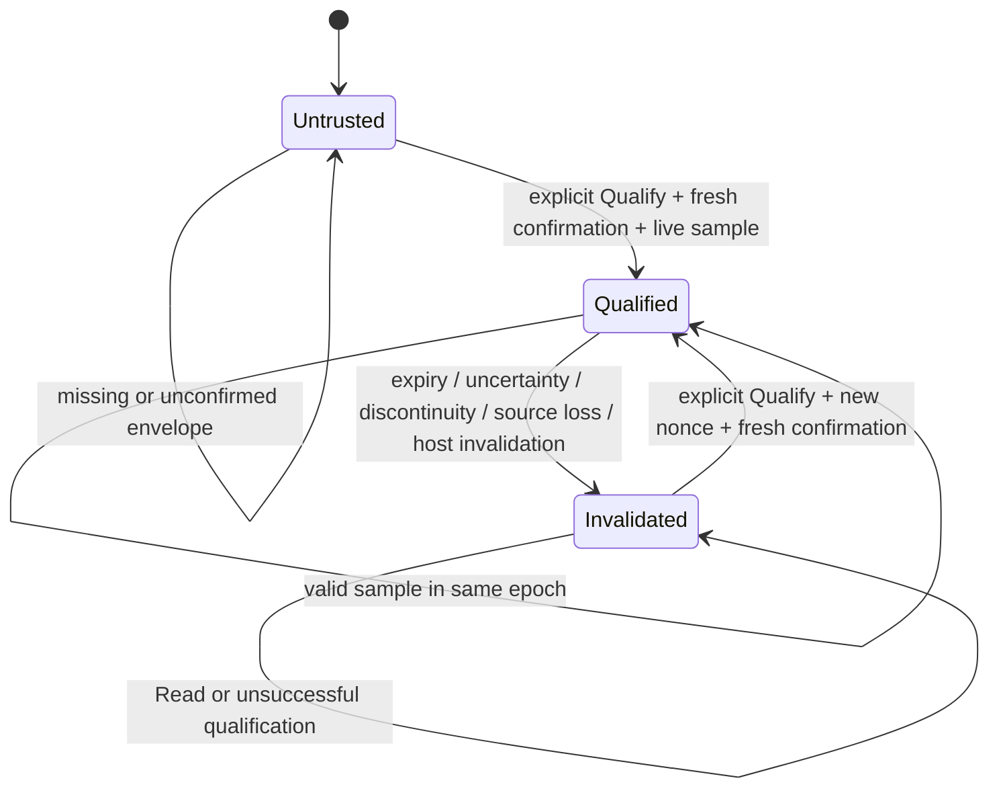

# MVP-B01-G02-CLOCK-01 — isolated qualified clock

2026-10-11. **ISOLATED COMPONENT IMPLEMENTED · OWNER ACCEPTANCE PENDING · CLOCK DEPLOYMENT QUALIFICATION NOT PROVEN.** Authorization: owner CLOCK-01 в текущем задании; NR1 documentation sync принят владельцем. Применяются [NR1 N1–N7](MVP-B01-G02-NORMATIVE-REVIEW.md), ADR-[L15](../docs/adr/ADR-L15-jwt-delayed-revocation.md)/[L16](../docs/adr/ADR-L16-organization-jwt-browser-session.md)/[L17](../docs/adr/ADR-L17-account-security-recovery-challenges.md). Historical checkpoint status не переписан.

## Scope и изменённые файлы

Все implementation/test файлы новые; существующие clock/JWT/issuer contracts не изменены.

| Файл | Назначение |
|---|---|
| [LocalQualifiedClockSource.cs](../src/Lms.Infrastructure/LocalQualifiedClockSource.cs) | Реализация существующего `IQualifiedClockSource`, envelope/verifier port, status, state machine, conservative projection и terminal invalidation |
| [LinuxLocalClockProbe.cs](../src/Lms.Infrastructure/LinuxLocalClockProbe.cs) | Один конкретный Linux x64 profile: локальные clock observations; не источник внешнего UTC trust |
| [LocalQualifiedClockSourceTests.cs](../tests/Lms.Infrastructure.Tests/LocalQualifiedClockSourceTests.cs) | State/fault/rounding/qualification/concurrency tests и Linux observation smoke |
| [QualifiedClockCompositionTests.cs](../tests/Lms.Infrastructure.Tests/QualifiedClockCompositionTests.cs) | NR1 boundaries, существующий JWT validator/expiry/deadline, два реальных isolated PostgreSQL issuer tests |
| Этот отчёт и [evidence](evidence/MVP-B01-G02-CLOCK-01/test-summary.json) | Результаты, команды, TRX, preservation manifest |

Actor → trusted host; use case → подтвердить временной interval, читать его и расходовать исходный operation budget. Invariants → unknown denies, outward bounds, новый epoch после квалификации, старые операции terminal. Entities/VO → observation, qualification request с nonce, confirmed envelope, coherent status/reading snapshot. Authorization/data-source matrix: client не участвует; Linux probe только измеряет; verifier является доверенным внутренним портом; consumer использует существующий `QualifiedAuthorityClock`. Только verifier может подтвердить envelope. В поставке единственный deployment verifier — `UnprovenLocalClockVerifier`, который **всегда отказывает**. Положительный verifier реализован только в synthetic tests.

Новых resource access paths нет. DB writes компонента отсутствуют; owning synchronization — один in-memory lock для qualification/read/invalidation. DB isolation/lock order/CAS/audit/retry/unknown-outcome N/A для clock; существующий issuer transaction protocol сохранён. Нет production DI, HTTP, schema/migrations, B08, H04/Ready, PRS1 exact, deploy или real-data pilot. Не создавались ветки/worktrees; commits/push/merge/rebase/checkout не выполнялись.

## Архитектура и состояния

`LinuxLocalClockProbe → LocalQualifiedClockSource : IQualifiedClockSource → QualifiedAuthorityClock : IAuthorityClock → существующие ComponentExpiry / ComponentJwt / PostgresComponentTokenIssuer / Deadline`.

Это реализация существующего clock source port, а не второй authority clock. `QualifiedAuthorityClock` не менялся: он дополнительно проверяет UTC/monotonic consistency, uncertainty limits и epoch; failure необратим для данного adapter instance. Существующий `PostgresComponentTokenIssuer` использует верхний UTC endpoint для S2/S3 и повторно валидирует токен после commit/disposal; `ComponentJwt` требует `U < exp`, не добавляет leeway. `ComponentExpiry` использует lower endpoint и floor до Unix seconds.



Явная замена действующей квалификации сначала прекращает старую; успешная замена получает новый nonce/epoch. Неуспешная замена оставляет `Invalidated`. `Read` никогда не выполняет requalification. Nonce связывает ответ verifier с конкретным request/anchor; stale ответ не подходит новому request. Это связывание внутри trusted host, **не криптографическое подтверждение внешнего источника**. Verifier обязан реально проверить evidence и текущий upstream/configuration; просто заполненный record не доказывает trust.

`Snapshot()` под одним lock даёт согласованные state/reading, source ID, boot epoch, qualification ID, evidence ID, upper age, UTC width, maximum age, exclusive valid-until и failure. Invalidated snapshot возвращает reading/текущие age/width как null, не выдаёт устаревший interval. Исторические identity/evidence поля остаются для диагностики. Reboot нового процесса начинает `Untrusted`. Ни trust, ни операции не восстанавливаются из disk cache.

После восстановления source необходим **новый** `QualifiedAuthorityClock` для новых операций. Старый adapter/deadline остаётся закрытым; смена epoch закрывает его даже если он не видел промежуточное `Invalidated`. Ожидание `Confirm` включено в age: после ответа выполняется новое измерение относительно прежнего anchor.

## Формулы conservative bounds

Все вычисления — integer ticks (100 ns), промежуточное умножение `Int128`; overflow/некорректные данные → invalidation. Пусть anchor имеет подтверждённый true UTC interval `[L0,U0]`, monotonic bracket `[m0−,m0+]`. Текущее измерение имеет `[m−,m+]`. `r=MaximumRateErrorPpb/10^9`, необходимо `0≤r<1`; этот rate bound должен включать discipline/slew, не только oscillator drift.

- `delta− = max(0,m−−m0+)`, `delta+ = m+−m0−`.
- `elapsed− = floor(delta−/(1+r))`, `elapsed+ = ceil(delta+/(1−r))`.
- Каждый endpoint дополнительно не меньше своего предыдущего значения; это консервативно при монотонном true elapsed. Regression raw counters → deny.
- `L=L0+elapsed−`, `U=U0+elapsed+`, uncertainty width `W=U−L`; это полная ширина, не half-width.
- Qualification age — `elapsed+`. Требуется `age < MaximumAge`, `U < ValidUntil`, `W ≤ MaximumUtcWidth`, `elapsed+−elapsed− ≤ MaximumElapsedWidth`. Equality для expiry отказывает; equality для width допустима.
- Существующий deadline хранит `cutoff = monotonicEarliest(t0)+B`; `Remaining=max(0,cutoff−monotonicLatest(now))`. Это lower bound remaining / upper bound elapsed относительно исходного t0. При unknown → null. Budget уменьшается, в том числе во время очередей/ожиданий; чтение не запускает новый budget.
- Существующий expiry: `exp=floor_seconds(min(L(issue)+900s,sessionExpiry,min(AccessValidUntil−600s)))`, только если `exp>U(issue)`. При true issue time≥L это даёт lifetime≤900s, условно на достоверности входного interval.
- Admission требует `U(a)<exp`; q требует `U(q)<D` при конечном D и positive remaining исходного deadline. Здесь проверены **входы и сравнения**, application gate не подключён. Объединение q/locks/domain checks — будущий B02 slice.

Положительный JWT leeway отсутствует; expiry вверх не округляется. Null D в существующем issuer означает явно unbounded по S3; clock не вводит scheduled grants и не меняет revocation или S2/S3/ProcessingRestrictions.

## Один локальный профиль и deployment blocker

Выбран **P1-LINUX-X64-LOCAL-CLOCK-01**, развитие локальной части ранее рассмотренного [P1-SINGLE-LOCAL](MVP-B01-G02-P1-QUALIFICATION.md): Linux x64, libc `clock_gettime`, локальный chrony discipline. Читаются `CLOCK_MONOTONIC → CLOCK_BOOTTIME → CLOCK_REALTIME → CLOCK_BOOTTIME → CLOCK_MONOTONIC`. Nanoseconds округляются наружу в ticks. До/после bracket проверяются `/proc/sys/kernel/random/boot_id`, kernel `current_clocksource`, `/proc/self/ns/time`. Missing/несогласованные identity, ошибки syscall/IO → unavailable. Другие ОС/ABI не поддерживаются.

Kernel различает monotonic, останавливающийся при suspend, и boottime, включающий suspend; realtime может испытывать corrections. Основание выбора API — [официальная kernel timekeeping documentation](https://www.kernel.org/doc/html/v5.16/core-api/timekeeping.html). Это описание clock semantics, не численный accuracy или availability contract.

Обнаружение: на протяжении epoch пересекаются интервалы `wall−monotonic` и `boottime−monotonic`. Пустое пересечение → step либо suspend/discontinuity; изменения identity → invalidation. Repeated small changes не сбрасывают окно сравнения. Explicit trusted host `Invalidate` позволяет передать независимо обнаруженное событие. Неподтверждённый/неоднозначный upstream или изменение discipline/configuration должен отвергать verifier через `IsCurrent` на каждом чтении.

**Конкретный blocker CLOCK-DEPLOY-01:** нет доверенного внешнего evidence, связывающего данный anchor с true UTC interval, подтверждённого maximum rate error включая chrony adjustments, срока/возраста пригодности, continuity/health oracle и поддерживаемого failure envelope. P1 snapshot chrony offset/root delay/root dispersion не является таким контрактом. Источник UTC upstream не выдуман; production numeric values **не установлены**. Реальная реализация подтверждающего verifier отсутствует намеренно; `UnprovenLocalClockVerifier` не квалифицирует даже успешно читаемый Linux clock. Новый обзор time vendors не выполнялся. На этом deployment qualification остановлена.

Обнаруживаемость ограничена sampling bracket: небольшие события внутри overlap, изменение и возврат source между reads, не сообщённые verifier события и общая ошибка kernel/hardware/VM не доказаны обнаружимыми. Нет непрерывного аппаратного monitor, защиты от Byzantine host/operator, гарантии VM migration или leap/discipline discontinuity. Их нельзя молча включить в supported production envelope. Raw probe smoke не измеряет true UTC accuracy и не доказывает rate bound. Clock values относятся к sampled instant; scheduler stall после sample до use остаётся check-to-action race.

Finite uncertainty **не доказывает bounded dispatch**: вызовы probe/verifier и scheduling могут ждать без hard bound. Компонент не обещает deadline callback, COMMIT completion, TX cutoff или recovery RTO. После возобновления нужна fresh check до каждого нового действия; конечный dispatch budget и cutoff margin должны иметь отдельное evidence. Неизвестный dispatch не равен нулю.

## Component evidence и проверки

Точные команды из `/home/tea/github/lms`, существующий SDK `10.0.401`, tests target `net10.0`:

```sh
/tmp/b07c2g/sdk/dotnet test tests/Lms.Infrastructure.Tests/Lms.Infrastructure.Tests.csproj --no-restore -m:1 -p:UseSharedCompilation=false --filter 'FullyQualifiedName~LocalQualifiedClockSourceTests|FullyQualifiedName~QualifiedClockCompositionTests|FullyQualifiedName~Clock01_real' --logger trx --results-directory /tmp/clock01/composition
/tmp/b07c2g/sdk/dotnet test Lms.sln --no-restore -m:1 -p:UseSharedCompilation=false --logger trx --results-directory /tmp/clock01/regression
```

Targeted **53/53 PASS**, failed 0, skipped 0. Первоначальный overlapping run 33/33 не суммируется. Полный regression **785/785 PASS**, failed 0, skipped 0: Domain 43, Application 272, Infrastructure 251, API 219. Это 732 прежних теста плюс 53 новых; targeted run не суммируется с regression. [Полный log](evidence/MVP-B01-G02-CLOCK-01/regression.log), [targeted log](evidence/MVP-B01-G02-CLOCK-01/composition.log), TRX в соответствующих подкаталогах evidence. Tests используют прежние disposable PostgreSQL 17.6 fixtures/full migrations; production DB не используется.

| Obligation | Component evidence / предел |
|---|---|
| UTC interval, rounding, age, uncertainty | Exact tick assertions; 10% synthetic rate fixture даёт `[10,13]` elapsed ticks и `[At+8,At+16]` UTC; численный fixture не deployment estimate |
| exp/D strictness | За 1 tick, ровно, после на 1 tick; asymmetric UTC interval использует U, не midpoint |
| 900/600 | Earliest UTC+900, D−600 и fractional floor; exact600 не даёт issuable second; прежние 901s/unknown/leeway tests повторяются |
| Original t0 | 60/480s sequences с uncertainty, monotonic remaining, queue-like advancement, zero remaining, epoch replacement не оживляет старый deadline |
| Expired/growing uncertainty | Age/valid-until equality, width overflow, arithmetic overflow deny |
| Clock discontinuities | Forward/backward wall steps, boottime discontinuity, counter regression, reboot/epoch, source change |
| Missing/ambiguous/error | Null/blank source, invalid intervals/counters, exceptions probe/verifier, lost trust; old operation закрыта |
| Requalification | Только explicit fresh verifier confirmation, nonce mismatch rejected, wait consumes age, old adapter terminal даже после пропущенной invalidation |
| Concurrent readers | 16 readers ×100 snapshots с 20 invalidation/requalification cycles; согласованные state/reading/epoch и old deadline denial |
| PostgreSQL composition | Реальный existing issuer возвращает валидный 900s JWT; invalidation после commit не даёт токену выйти |
| Live local probe | Linux observation smoke PASS; с production verifier квалификация остаётся Untrusted |

Component evidence доказывает алгоритмическое поведение при контролируемых truthful inputs и композицию с существующими компонентами. Fake verifier, fake drift и fake clock **не квалифицируют физический источник**. Реальные step/suspend/reboot faults host не инжектировались; physical envelope, независимый time oracle, bounded dispatch, deployment acceptance **NOT PROVEN**. HTTP/browser/E2E clock integration **NOT RUN**, scope запрещён. Старые API tests в regression — compatibility evidence, не HTTP cutover acceptance.

## Условия B02 / application deadline

1. Отдельная owner authorization для подключения; production DI/HTTP здесь отсутствуют.
2. До production trust нужен принятый verifier с проверяемым external UTC/rate/age/continuity envelope для этого профиля и испытания его реальных failure modes. Client/config flag не может заменять подтверждение. Adapter width limits должны согласоваться с подтверждёнными bounds.
3. Capture единственного deadline на earliest controlled ingress t0, до очереди/header/body. Передать тот же handle через все stages; после expiry/invalidation/requalification старая операция terminal, restart/retry не восстанавливает budget.
4. Fresh qualified read и remaining перед admission, q после waits/locks, каждым новым stage, COMMIT dispatch и enqueue; U<exp/U<D в применимых точках. Не добавлять обычную grant freshness или немедленный revoke. Current processing/serialization сохраняются.
5. Отдельно принять dispatch assumptions/cutoff margin и supported scheduler failure envelope. Finite UTC interval не устраняет pause между check и dispatch. Issuance и late ACK требуют собственного application deadline; существующий post-commit JWT validation сам по себе его не реализует.
6. PhysicalPending/OutcomeUnknown, immutable files, finite accounting/recovery остаются отдельными obligations. CLOCK-01 их не закрывает; нет claims о Ready, last TX, bounded physical completion.

## Guardrails §7 / self-review

| Проверка | Результат |
|---|---|
| Actor/use case/invariants/states | covered — контракт и state diagram выше |
| S2/S3/PRS1 и blocked gates | covered — исходные production contracts побайтово сохранены; gates не открыты |
| Server org/course/group/ownership, IDOR | not applicable — новых command/query/access paths нет; существующая regression повторена |
| Subjects/embedded sources/restriction narrowing | not applicable — processing logic не менялась, source здесь только time port |
| Lists/counts/aggregates/post-pagination | not applicable — новые queries отсутствуют |
| Attachments/parent bypass/history | not applicable — storage/history не менялись |
| Transactions/locks/CAS/retry/unknown/stale authority | covered — component lock; DB protocol не изменён; issuer composition проверена; auto retry отсутствует |
| Validation/limits/safe errors | covered — malformed/unknown/expired/overflow deny; deployment numerical bounds blocked |
| Unit/integration/negative/E2E | clock positive/negative + real PG + regression; новый access-path negative matrix N/A, HTTP/E2E integration NOT RUN |
| Неавторизованные schema/API/security/unrelated edits | covered — только новые перечисленные component/test/report/evidence files |
| Real data/secrets/unsafe logs/readiness claims | covered — synthetic fixtures, generic fault reasons, bearer values не выводятся, deployment trust blocked |
| Фактические проверки/remaining gaps | targeted и regression PASS; preservation итог ниже; physical source/dispatch NOT PROVEN |

Специализированные `model-domain`/`implement-use-case`/`implement-feature` skills отсутствуют в доступном каталоге; их выполнение не заявляется. Self-review выполнен последовательно, без subagents.

## Preservation и итог

Baseline 553 tracked/untracked files (кроме `.obsidian`) сохранён до implementation. Ignored build outputs не входят в coverage. SHA-256 preservation, HEAD/branch/index и полный test summary — в [preservation.json](evidence/MVP-B01-G02-CLOCK-01/preservation.json) и [test-summary.json](evidence/MVP-B01-G02-CLOCK-01/test-summary.json). Checkout уже был dirty на `codex/l1-s4-jwt-api-authorization`, HEAD `492e30aef65bbddd24f107903bfaa54a563abe39`; в соответствии с явным запретом branch не переключался на main. Existing checkpoint documentation не изменялась. Итоговая проверка: **PASS — 553/553 baseline files без изменений; HEAD, branch и byte hash index сохранены; 14 local links проверены; whitespace новых файлов PASS**. Общий `git diff --check` отмечает только исходный `docs/content/COURSE-CONTENT-SPEC.md:1325` (пустая строка в EOF); этот посторонний файл не исправлялся.

**CLOCK-01 OWNER ACCEPTANCE PENDING · CLOCK DEPLOYMENT QUALIFICATION NOT PROVEN · G02 BLOCKED · H04/READY BLOCKED · B08 NOT AUTHORIZED · PRS1 EXACT OFF · S4 HTTP CUTOVER NOT AUTHORIZED.** Остановиться на owner acceptance; следующий slice не начат.
