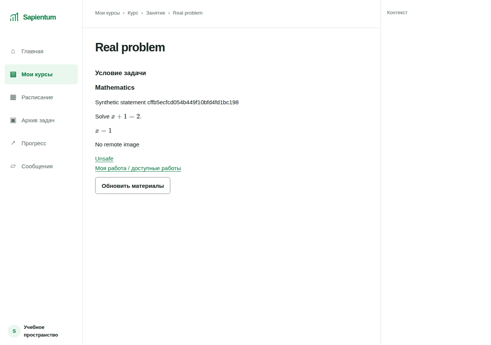

# MVP-BROWSER-READ-01 — synthetic browser integration

2026-10-12. **IMPLEMENTED — OWNER ACCEPTANCE PENDING.** Основание: текущее owner decision **HTTP-WORKSPACE-READ-01 ISOLATED ACCEPTED · BROWSER-READ-01 SYNTHETIC AUTHORIZED**. Это отчёт локального синтетического среза, не production readiness.

## Контракт и границы

Student / назначенный Teacher → Мои курсы → Курс → опубликованное занятие → задача / условие → назад и вперёд. Инварианты: настоящий server-issued JWT, S2 validation, S3 course scope, same-org current ProcessingRestrictions, qualified time и исходный request deadline, immutable publication и точный parent chain. Entities/VO: TokenAuthority, ResourceReference(Course), ContentSelection, ContentLink, PublishedContentVersion, LessonAccess, ApplicationDeadline. Пользовательских переходов состояния и writes нет; меняются только transient UI loading/success/error и история навигации.

Использованы принятые HTTP adapters, ADR-L15/L16/L18, S3 и NR1 без изменения policy. Прочитаны repository AGENTS, guardrails и reconciliation. Специализированные `model-domain`, `implement-use-case`, `implement-feature` skills недоступны; их выполнение не заявляется. Нет production Program.cs cutover, refresh/cookie issuance, auth UI, Submit/Review, upload, review queue, schema changes, новой authorization policy или расширения NR1.

| Actor / ресурс | Authority и проверка | Реальный источник | UI |
|---|---|---|---|
| Student / Teacher, список | Выданные S2 grants + S3 + current processing до выдачи строк | PostgreSQL CourseNavigationQueries | Существующая «Мои курсы»; progress null не заменён фикцией |
| Курс | Signed course grant, server-resolved org/course | CourseRegistry + immutable publication | Read-only режим существующего CoursePage |
| Занятие | Course scope + exact version/lesson + published/available | AccessLessons + PublishedContentVersions | Read-only режим LessonPage |
| Условие | Тот же parent chain + exact nested problem | Только student-safe published Markdown | Read-only режим ProblemPage, существующий MarkdownContent/KaTeX |
| Work / submission / review / attachments | Никакого разрешения этим срезом | Не читаются | Не добавлены в content DTO и не включены в test-host routes |

## Host и session

`BrowserReadTests.cs` переиспользует restricted-login disposable PostgreSQL fixture и composition `HttpHost`, запускаемый в этом режиме через Kestrel `127.0.0.1:0`. Случайный порт, приложение, child Node process, browser context и контейнер принадлежат тесту и закрываются после него. Синтетическая clock qualification реализована только в test assembly; проверка JWT и реальные qualified-clock компоненты не подменены.

S2 provisioning/session/issuer создают настоящие session и token. JWT передаётся в Node по anonymous stdin pipe, затем Playwright устанавливает **существующий** `window.lmsAuth` с closure в памяти вкладки. API получает обычный Authorization Bearer и проверяет ComponentJwt. Токен не попадает в argv, env, URL, HTML, JS bundle, файл, localStorage/sessionStorage, cookie или public endpoint. На 401 adapter очищает access value. Test-only init script может устанавливать этот выданный тестовый token при document navigation; это не production reload/refresh implementation и не новый session contract.

Сервер отдаёт только отдельную browser-read build directory; source tree/fixtures не являются web root. Нет HTTP endpoint для login/token/clock/restrictions. Fixture commands идут через child stdout/stdin, недоступный странице. Public GET на auth/fixture/token/file/source paths возвращает 404; неаутентифицированные protected reads — пустой 401. Server logging providers отключены; request headers/bodies/DB credentials не логируются. Browser URLs/console/page errors проверяются на все выданные JWT, случайный private statement canary и синтетические identity/actor/session/org/context markers. HAR/trace/video/persistent profile не сохраняются. Failure diagnostics редактируют JWT-shaped strings.

Тест вставляет **новую** immutable publication. Первый development run обнаружил ошибочный UPDATE опубликованного fixture: PostgreSQL правильно отклонил его (`Published content is immutable`). Ошибка исправлена вставкой; trigger/invariant не ослаблены.

## Frontend integration

Добавлены небольшие exact-shape content adapters. Они отвергают лишние поля (включая permissions/work), несовпадающий parent, чужой/внешний href, query/token suffix и несовпадающую version. Это защита transport/navigation; authorization по-прежнему на сервере. Проверенные API href преобразуются в same-origin UI route удалением `/api/v1`.

Существующие страницы экспортируют read-only режимы с общим ContentPage: тот же AppShell, breadcrumbs, списки, loading/error/empty primitives и Markdown/LaTeX renderer. Нет invented assignment IDs, progress, student/teacher profiles, submission/review state или возможностей записи. Raw HTML не исполняется, remote images не загружаются, unsafe URL/TeX trust не разрешаются существующим renderer.

`App contentReads` включён **только** отдельным `browser-read/main.tsx`. Обычный `src/main.tsx` и production startup не переключены: production protected-content activation остаётся будущим разрешённым cutover. Тест проверяет собранный React в настоящем Chrome, не jsdom/mock DTO. Условия содержат уникальный случайный marker из PostgreSQL, отсутствующий в public build.

Работающие переходы:

1. `/courses` → API `/api/v1/courses` → курс по возвращённому course.id (в принятом list DTO нет href).
2. `/courses/http-own` → API course → занятие по **вернувшемуся lesson.href**.
3. `/courses/http-own/versions/{version}/lessons/lesson` → API lesson → задача по **вернувшемуся problem.href**.
4. `.../problems/problem` → API statement → Markdown, inline и display LaTeX.
5. Browser Back / Forward повторно запрашивают lesson/problem; breadcrumbs возвращают к занятию, курсу, списку. UI не держит query cache между маршрутами.
6. «Обновить материалы» очищает старое состояние и делает новый GET; 503/network error допускает явный GET retry; 401/403 не запускают автоматический retry/refresh.

## Проверки браузера и negative-access matrix

Один полный сценарий выполняется отдельно для Student и Teacher. Playwright не использует route fulfill/interception или mock responses. Positive controls предшествуют denial families.

| Проверка | Ожидаемое поведение / evidence |
|---|---|
| Доступный курс, занятие, задача | 200 из PostgreSQL, title/summary/canary, две KaTeX формулы, ссылки API |
| Empty lesson / course / list | Пустые реальные DB-backed коллекции; никаких демо-строк |
| Чужой course той же org, foreign org, отсутствующий course | Каждый из course/lesson/problem routes даёт одинаковый пустой 403 |
| Invalid version, locked/missing lesson, swapped problem parent | Пустой 403; HIDDEN metadata/body отсутствуют |
| Missing token / forged signature | Пустой 401; настоящая JWT validation |
| Expiry в открытом problem | Exact synthetic 15m →401, memory token очищен, statement убран после запроса |
| Clock loss | Новый реально выданный JWT сначала даёт 200; потеря qualification →401 |
| Restriction во время открытой страницы | Committed current restriction → refresh/default-cache GET/history получают 403; list становится пустым |
| Restriction после materialization до response | AfterContent hook фиксирует restriction настоящим adapter; final gate отдаёт пустой 403 |
| Processing DB failure | REVOKE SELECT в disposable DB →503 без content; восстановление права + явный retry →200 |
| Offline/reconnect | Ошибка и удаление отображаемого state после refresh; reconnect + explicit retry →200 |
| Markdown security | Raw script, javascript link и remote image не исполняются/не загружаются; нет внешних requests |
| Public resources / logs / URLs / storage | JWT/private markers отсутствуют, cookies/storage/cache/IndexedDB/SW пусты; только synthetic screenshots |
| Group/assignment/role/moved membership | Browser использует реальные group-grants обоих ролей; дополнительные отрицательные issuer/S3/HTTP cases выполняются backend regression. Common course content не становится group-private: policy не изменена |
| Attachment parent, submission, review, duplicates | Not applicable — endpoints не зарегистрированы, writes/UI не подключены; прямой file path 404. Existing backend regression сохраняет соответствующие protections |
| CSRF/Origin refresh, refresh failure, session expiry mid-edit | Not applicable — нет cookie-auth mutation/refresh и редактируемого draft. Expiry read flow проверен |

## HTTP cache и пределы утверждения

ApiClient использует `cache: 'no-store'`; принятый ingress ставит `Cache-Control: no-store` на success/denial. Дополнительно браузер дважды читает statement с **обычной default cache policy**, затем fixture фиксирует restriction и очередной default-cache request получает пустой 403. History возвращается с новым серверным запросом. Network.enable включён для наблюдения; browser cache **не отключается** через CDP/Playwright routing. Проверяются `requestServedFromCache`, disk/prefetch/service-worker flags, отсутствие API 304, no-store и отсутствие Set-Cookie. Web storage, CacheStorage, IndexedDB и cookies пусты.

ContentPage и «Мои курсы» повторно запрашивают данные на `pageshow.persisted`; simulated restoration отдельно покрыта frontend test. Это не доказательство универсального BFCache поведения всех браузеров. Уже показанные байты, screenshots, browser memory/OS paging и пользовательские копии не стираются задним числом. Без нового запроса экран может продолжать показывать ранее полученные данные; push-revocation не реализован. Accepted in-flight semantics и промежуток между final gate и последующим restriction commit не изменены.

## Команды, результаты и evidence

Точные команды окружения и результаты добавлены в execution section ниже. Воспроизводимый запуск: [tools/browser_read/README.md](../tools/browser_read/README.md). Без `LMS_BROWSER_READ=1` два browser tests явно SKIP; отсутствие зависимостей при включённом флаге — FAIL.

Секретов нет в сохранённых screenshot/results. [Student results](evidence/MVP-BROWSER-READ-01/Student/results.json), [Teacher results](evidence/MVP-BROWSER-READ-01/Teacher/results.json).

| Скриншот | Student | Teacher |
|---|---|---|
| Мои курсы | [01](evidence/MVP-BROWSER-READ-01/Student/01-courses.png) | [01](evidence/MVP-BROWSER-READ-01/Teacher/01-courses.png) |
| Курс | [02](evidence/MVP-BROWSER-READ-01/Student/02-course.png) | [02](evidence/MVP-BROWSER-READ-01/Teacher/02-course.png) |
| Занятие | [03](evidence/MVP-BROWSER-READ-01/Student/03-lesson.png) | [03](evidence/MVP-BROWSER-READ-01/Teacher/03-lesson.png) |
| Условие / LaTeX | [04](evidence/MVP-BROWSER-READ-01/Student/04-statement.png) | [04](evidence/MVP-BROWSER-READ-01/Teacher/04-statement.png) |
| Empty state | [05](evidence/MVP-BROWSER-READ-01/Student/05-empty-course.png) | [05](evidence/MVP-BROWSER-READ-01/Teacher/05-empty-course.png) |
| Denied | [06](evidence/MVP-BROWSER-READ-01/Student/06-access-denied.png) | [06](evidence/MVP-BROWSER-READ-01/Teacher/06-access-denied.png) |
| Restriction | [07](evidence/MVP-BROWSER-READ-01/Student/07-restriction.png) | [07](evidence/MVP-BROWSER-READ-01/Teacher/07-restriction.png) |
| Server error | [08](evidence/MVP-BROWSER-READ-01/Student/08-server-error.png) | [08](evidence/MVP-BROWSER-READ-01/Teacher/08-server-error.png) |
| JWT expiry | [09](evidence/MVP-BROWSER-READ-01/Student/09-expired.png) | [09](evidence/MVP-BROWSER-READ-01/Teacher/09-expired.png) |
| Tablet viewport | [10](evidence/MVP-BROWSER-READ-01/Student/10-tablet-statement.png) | [10](evidence/MVP-BROWSER-READ-01/Teacher/10-tablet-statement.png) |
| Clock loss | [11](evidence/MVP-BROWSER-READ-01/Student/11-clock-lost.png) | [11](evidence/MVP-BROWSER-READ-01/Teacher/11-clock-lost.png) |



## Что нужно для фотографий и проверки

1. Отдельно разрешить protected assignment/work/submission/review read contracts. Course content ID не является assignment ID; сервер должен разрешать immutable affiliation и student/teacher/group ownership. Private profiles/history/permissions остаются отдельными DTO с собственными affected subjects/current processing checks.
2. Отдельно разрешить photo upload/claim/download integration: private temporary storage, uploader/course/org/context binding, validation размеров/type, expiry/cleanup/quarantine, независимый parent gate для каждого download/Range/preview. Ни public object URL, ни content grant не дают file access.
3. Для Submit/Review writes зафиксировать transaction owner/isolation, принятый lock order, current restrictions в commit transaction, expected version/CAS, immutable history/audit, commit deadline, idempotency/retry и unknown-outcome reconciliation. Не повторять command автоматически после timeout/lost acknowledgement. В этом срезе новая write-семантика не реализована и не разрешена.
4. Подключить существующие upload/submit/review UI к этим отдельно принятым защищённым routes, затем выполнить настоящий browser flow «фото → submit → teacher view/annotation → revise → resubmit → accept», отрицательные file-parent/ownership/current-processing и retry/duplicate/conflict tests. Review queue/counts фильтровать на сервере до pagination/aggregation.
5. Production session integration, CSRF/Origin/cookie/refresh coordination, deployment clock qualification, private storage/deadline evidence, legal/security/pilot gates потребуют отдельных решений. Локальная test session их не заменяет.

## Guardrails §7 / self-review

| Check | Status и основание |
|---|---|
| Actor/use case/invariants/states | covered — contract и browser matrix выше |
| Accepted S2/S3/PRS1/NR1 | covered — production adapters/policy неизменны, synthetic test clock только в test assembly, PRS1 EXACT OFF |
| Org/course/group/ownership | covered — реальные server gates + positive/negative browser/backend tests; client IDs selectors only |
| Affected subjects/embedded sources | covered — immutable student-safe content; personal work/profile/history не добавлены |
| Lists/counts/aggregation | covered — принят server filter; hidden metadata отсутствуют, нет новых counts/pagination |
| Attachments/history | not applicable to new read paths — нет access path; absent endpoints проверены, future contract явно отделён |
| Transaction/locks/CAS/retry/unknown outcome | not applicable to user reads; fixture restrictions используют accepted processing adapter, revision CAS и audit protocol без обхода; нет новых writes |
| Validation/limits/safe errors | covered — exact DTO/parent validators, shared deadline/JWT gates, пустые denial responses, нет command retry |
| Unit/integration/negative/E2E | covered — фактические команды/результаты ниже; production/multi-browser/physical-device evidence NOT PROVEN |
| Unapproved edits/schema/security | covered — narrow frontend/test-only changes; Program, schema, S2/S3/NR1 и checkpoint docs сохранены |
| Real data/secrets/logs/readiness | covered — synthetic-only; memory/pipe JWT, no secret public artifact, no trace/HAR, no release claims |
| Actual tests / remaining gaps | covered — failures и reruns раскрыты; owner acceptance ещё не получена |

## Ограничения и сохранение checkout

Проверен локальный headless Chrome/Chromium, desktop 1280×900 и tablet viewport 768×1024. Safari/Firefox, physical tablet/touch/assistive technology, production CSP/proxy/TLS/session/reload/clock, physical socket drain, deployment cancellation latency, multi-node/edge buffering и real-data compliance **NOT PROVEN**. Read path не доказывает дальнейший photo/workflow path.

Сохранена dirty ветка `codex/l1-s4-jwt-api-authorization`, HEAD `492e30aef65bbddd24f107903bfaa54a563abe39`, index и посторонние изменения. `main` не переключался согласно AGENTS запрету переключать dirty checkout. Baseline SHA-256 comparison выполняется для всех существовавших tracked/untracked files; изменения ограничены перечисленным ниже срезом. Старые checkpoint документы не редактировались. Общий `git diff --check` на исходном dirty tree сообщает существующий `docs/content/COURSE-CONTENT-SPEC.md:1325: new blank line at EOF`; файл сохранён byte-for-byte.

Изменены: `src/Lms.Web/.gitignore`, `src/Lms.Web/src/App.tsx`, `src/Lms.Web/src/api/client.ts`, существующие Course/Courses/Lesson/Problem page modules; только test composition в `tests/Lms.Api.Tests/ProtectedCoursesHttpTests.cs`. Новые: `api/contracts/workspaceContent.ts`, `features/content/ContentPage.tsx`, `test/workspaceContent.test.tsx`, `browser-read/`, `vite.browser-read.config.ts`, `tests/Lms.Api.Tests/BrowserReadTests.cs`, `tools/browser_read/`, этот отчёт и evidence directory.

Commit, push, merge, rebase, deploy, production cutover, новый worktree и index staging не выполнялись. Остановка на owner acceptance.

**HTTP-WORKSPACE-READ-01 ACCEPTED · BROWSER-READ-01 SYNTHETIC IMPLEMENTED — OWNER ACCEPTANCE PENDING · CLOCK-DEPLOY-01 OPEN · G02 BLOCKED · H04/READY BLOCKED · PRS1 EXACT OFF · S4 HTTP CUTOVER NOT AUTHORIZED.**

## Execution results

Фактическое окружение: .NET 10 SDK `/tmp/b07c2g/sdk/dotnet`, bundled Node 24/pnpm, Playwright, `/opt/google/chrome/chrome` **154.0.8037.57**, disposable PostgreSQL 17.6. Команды запускались в `/home/tea/github/lms`:

```sh
PATH=/home/tea/.cache/codex-runtimes/codex-primary-runtime/dependencies/node/bin:$PATH pnpm --dir src/Lms.Web test
PATH=/home/tea/.cache/codex-runtimes/codex-primary-runtime/dependencies/node/bin:$PATH pnpm --dir src/Lms.Web exec vitest run --maxWorkers=1
PATH=/home/tea/.cache/codex-runtimes/codex-primary-runtime/dependencies/node/bin:$PATH pnpm --dir src/Lms.Web build
PATH=/home/tea/.cache/codex-runtimes/codex-primary-runtime/dependencies/node/bin:$PATH pnpm --dir src/Lms.Web exec vite build --config vite.browser-read.config.ts

export LMS_BROWSER_READ=1
export LMS_BROWSER_NODE=/home/tea/.cache/codex-runtimes/codex-primary-runtime/dependencies/node/bin/node
export LMS_PLAYWRIGHT_MODULE=/home/tea/.cache/codex-runtimes/codex-primary-runtime/dependencies/node/node_modules/playwright/index.mjs
export LMS_BROWSER_EXECUTABLE=/opt/google/chrome/chrome
/tmp/b07c2g/sdk/dotnet test Lms.sln --no-restore -m:1 -p:UseSharedCompilation=false --logger trx --results-directory /tmp/browser-read/regression
/tmp/b07c2g/sdk/dotnet test tests/Lms.Api.Tests/Lms.Api.Tests.csproj --no-restore -m:1 -p:UseSharedCompilation=false --filter 'FullyQualifiedName~Browser_read' --logger trx --results-directory /tmp/browser-read/e2e-final
```

- **Backend regression: 947/947 PASS**, failed 0, skipped 0: Domain 43, Application 340, Infrastructure 258, API 306. В API включены обе browser роли и существующие HTTP courses/workspace negative suites. [Log](evidence/MVP-BROWSER-READ-01/regression.log).
- **Final browser E2E: 2/2 PASS**, Student и Teacher, failed 0/skipped 0. Это повторное выполнение тех же двух tests после финального CSS-class/standard Button выравнивания; не складывается с backend total. Финальные screenshots соответствуют этому запуску. Для каждой роли наблюдалось **46 API responses**, cached API responses **0**, проверено **24** public resource URLs. [Log](evidence/MVP-BROWSER-READ-01/e2e-final.log).
- **Frontend: 398/398 PASS**, 14 files, включая 11 новых content tests; финальный последовательный запуск [log](evidence/MVP-BROWSER-READ-01/frontend-serial.log). Первый обычный parallel run также 398/398 [log](evidence/MVP-BROWSER-READ-01/frontend.log). Повторный parallel run во время backend regression дал **397 PASS / 1 FAIL** в неизменённом `attachments.test.tsx`, `selects one image and returns only confirmed attachment IDs`: assertion прочитал callback до появления attachmentId. [Failure log](evidence/MVP-BROWSER-READ-01/frontend-final.log). Посторонний тест не изменён; последующий serial suite прошёл. Нестабильность parallel run не скрыта и не объявлена исправленной.
- **TypeScript + normal Vite build PASS**, [log](evidence/MVP-BROWSER-READ-01/frontend-build-final.log). **Separate test UI build PASS**, [log](evidence/MVP-BROWSER-READ-01/test-build-final.log); Vite предупреждает о размере bundled test chunk >500 kB, это не ошибка сборки.
- Changed/new source whitespace **PASS**; известный unrelated full-diff warning выше сохранён. Saved text/TRX JWT-pattern scan **PASS**; это дополнительная проверка к runtime canary assertions, не единственное security evidence.
- **648/656 baseline files неизменны**, 8 разрешённых существующих файлов изменены; branch/HEAD/index неизменны. [Preservation](evidence/MVP-BROWSER-READ-01/preservation.json). Новые файлы среза не входят в baseline denominator. [TRX counters / summary](evidence/MVP-BROWSER-READ-01/test-summary.json).

**Owner acceptance pending. Ни E2E ACCEPTED, ни SYNTHETIC MVP ACCEPTED, ни PILOT AUTHORIZED этим отчётом не объявляются.**
