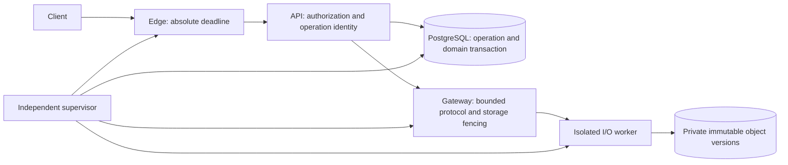

# G02/A02 — Bounded execution: архитектура и инварианты

> **2026-10-12 — HISTORICAL PHYSICAL-COMPLETION DESIGN.** The current Teacher Revocation contract is [logical deadline without hard-real-time completion](TEACHER-REVOCATION.md), accepted in the [owner decision](../../codex/TEACHER-REVOCATION-OWNER-DECISION.md). Supervisor, worker isolation, physical fencing/quiescence, and worst-case PG/FS/kernel/edge termination bounds in this document are no longer requirements or production-readiness blockers for Teacher Revocation. The document and its negative evidence are retained unchanged as history; they are not PASS and do not prove physical completion. Logical deadline/cancellation/no-late-success and all data/replay/access safeguards remain required.

> **2026-10-12 — bounded teacher revocation.** [Действующий scoped contract](TEACHER-REVOCATION.md): fresh issue/refresh, JWT≤15m, immutable operation≤30m, revoke≤60m в выбранном bounded execution envelope. Для ordinary revoke двухчасовой D и D−10m superseded; неограниченный late COMMIT/egress не удовлетворяет новому контракту. История ниже сохранена. Processing/file safety, PRS1 и release gates не сняты; общий HTTP/physical bound NOT PROVEN.

> **MVP photo storage override — 2026-10-12.** [Owner-authorized exact diff](../../codex/MVP-STORAGE-RISK-ACCEPTANCE.md): physical original tampering risk accepted; fs-verity/kernel seal, retained FD/mmap exclusion proofs and developer filesystem qualification removed only for Sapientum solution photos. Completed private upload, parent/S2/S3/current processing/deadline and all other NR1 guarantees remain required. STORAGE-PROFILE-02 CANCELLED; G02 production BLOCKED. Historical clauses/results below are preserved.

> **NR1 effective notice — 2026-10-11.** D6 заменяет только I6 all-executors-stop на N1–N3/N6 в NR1 scope. Производные physical completion/full-stop выводы читаются через D1–D4/D8. I1–I5/I7 остаются safety obligations с отдельным physical accounting; quiescence обязательна для seal/purge. Исторический A02 design и его отрицательные выводы не исправлены и не стали PASS.
> Нормативный источник: [N1–N7 / точный D1–D8](../../codex/MVP-B01-G02-NORMATIVE-REVIEW.md), [принятое решение](../../codex/L03-OWNER-DECISION-REGISTER.md), [sync results](../../codex/MVP-B01-G02-NR1-SYNC-RESULTS.md). Только controlled SyntheticOnly и отдельно принимаемые routes; неопределённый scope → blocked. Credential issuance, grants, B08 publication, general jobs и внешние irreversible effects не получают автоматического исключения. CLOCK NOT PROVEN; технически NR1 NOT IMPLEMENTED / NOT ACCEPTED.
> Исторический текст ниже сохранён; старые failure results не превращены в PASS.

2026-10-09. **DESIGN PROPOSAL; runtime NOT IMPLEMENTED; T04 NOT PROVEN; S4 BLOCKED.**
Основание: владелец разрешил G02/A02 DESIGN, отдельно разрешил сохранить документы в текущей ветке `codex/l1-s4-jwt-api-authorization` канонического `/home/tea/github/lms`. Новая реализация требует отдельного разрешения. [Модель отказов](L1-G02-FAILURE-MODEL.md), [варианты](../../codex/L1-G02-OPTIONS.md), [verification plan](../../codex/L1-G02-VERIFICATION-PLAN.md), [решение владельца](../../codex/L1-G02-OWNER-DECISION.md).

## 1. Что требуется обеспечить

[ADR-L15 / T04](../adr/ADR-L15-jwt-delayed-revocation.md) неизменен: обычный HTTP/API ≤60s, явно длительный upload/download ≤480s, запас до AccessValidUntil 600s, access JWT ≤900s, ordinary revoke ≤7200s. Время включает очередь, body, storage, PostgreSQL, cancellation, освобождение handles и последнюю отправку edge. Успешный ответ, прекращение ожидания и завершение операции — разные события.

Различаем: (a) отсутствие поздней публикации и повторного применения; (b) прекращение всей работы, вызванной запросом. Quarantine может обеспечить (a), но не доказывает (b). Запись даже в недоступный временный объект после deadline не считается выполнением T04. Recovery после deadline не имеет права продолжать пользовательскую запись, допубликовывать её или давать ей новый бюджет.

Текущие `LocalFileAttachmentStorage`/`AttachmentService`/`AttachmentsController` и `docker/nginx.conf` не реализуют этот контракт. Синхронные open/move/delete, compensation с `CancellationToken.None`, отсутствие общего edge deadline остаются историческими G02 blockers. Этот проект их не исправляет.

## 2. Рекомендуемая граница исполнения

Выбрать для следующего отдельно разрешённого этапа **storage gateway с ограниченным протоколом + изолированные процессы I/O + независимый supervisor + контролируемый edge**. PostgreSQL входит в доказательство завершения как самостоятельный исполнитель. Gateway — проект нового контракта, не утверждение, что обычный HTTP storage уже его предоставляет.

- API не получает mount, файловые handles или credentials для прямого изменения originals; включая stat, flush, dispose и cleanup. Он проверяет JWT, scope, resource/context и current processing restrictions.
- Gateway принимает только структурированные операции с лимитами размера/очереди/конкурентности. Произвольные пути, shell, overwrite и wildcard delete запрещены.
- I/O process получает доступ только к одному private staging объекту своего поколения. Он не изменяет опубликованный объект, каталог публикации, БД или чужие поколения.
- Supervisor вне failure domain worker отслеживает неизменный deadline, отзывает capabilities, закрывает delivery, отменяет/останавливает и наблюдает завершение. Supervisor на том же зависшем kernel не независим для отказа этого kernel.
- Единственная DB transaction связывает operation identity, attachment metadata, eligibility/claim и результат domain mutation. Workers не имеют самостоятельного доступа к этим таблицам.
- Edge не раздаёт storage по URL напрямую и не сохраняет разрешение на бесконечную выдачу. Каждый download/Range — новая авторизованная операция с собственным пределом, без продления старого.

Стрелка supervisor → PostgreSQL означает обязательство контролировать отдельный backend/инфраструктуру, а не доказанную способность SIGKILL завершить WAL flush. Никакого распределённого ACID между FS и PG не предполагается.

## 3. Durable identity и состояния

Предлагаемая логическая запись (не migration): `OperationId`, caller idempotency key, actor/org/course/context, kind, canonical request digest, `Generation`, gateway/storage epoch, deadline, state/version, immutable object version/hash/length, result reference и минимальные evidence IDs. OperationId создаётся до storage side effects. Unique `(actor, org, kind, idempotencyKey)` связывает retries с одной записью; иное содержимое с тем же ключом → conflict. Identity/status доступны только после проверки owner/scope; ID не bearer credential.

Operation row и idempotency binding должны быть подтверждённо durable до начала работы. Неизвестный исход их создания → никаких storage side effects; повторно установить исход по тому же ключу. Число незавершённых операций и объём orphan bytes ограничены. Tombstone identity нельзя удалить раньше доказанного конца replay horizon; если horizon не установлен, не делать автоматическую очистку dedup evidence.

| Состояние | Разрешённое действие и переход |
|---|---|
| Registered | Durable identity подтверждена; можно начать Staging при действующем deadline |
| Staging | Только private объект данного поколения; после seal receipt → Sealed |
| Sealed | Immutable bytes durable по контракту storage; атомарная PG transaction может сделать Committed |
| Committed | В PG одновременно записаны результат, object reference и допустимые metadata; повтор не применяет domain command |
| Aborted | Доказанно нет результата и незавершённого исполнителя; новое применение этой operation запрещено |

`OutcomeUnknown`, `Quarantined` и `FencingPending` — состояния знания/control plane, не безусловные замены `Committed`. Потеря ответа не переписывает committed факт в Aborted. При недоступной PG control plane хранит quarantine по operation/generation независимо; после restart default deny до сверки. Для claim/delete применяются отдельные OperationId и тот же atomic-result contract.

Предлагаемые protocol verbs: `Begin`, `PutChunk(seq, digest)`, `Seal`, `Inspect`, `Fence`, `Read(version, deadline)`, `PurgeExactVersion`. Каждый несёт operation/generation/epoch/deadline и имеет bounded response. Повтор chunk с тем же digest — тот же результат; иной digest — conflict. Seal возвращает receipt с object version/hash/length и durable epoch. Получение receipt не публикует файл. Purge доступен только recovery identity с отдельным доказательством отсутствия ссылок и quiescence. Operation retry не продлевает deadline; после истечения разрешено только выяснение исхода. Новый пользовательский запрос требует новой авторизации и не должен дублировать неизвестный старый command.

## 4. Fencing: где именно действует запрет

Generation операции не равен generation grant. Первый исключает конкурирующих исполнителей; второй участвует в JWT/scope policy. Обычный revoke не превращается в обязательную DB freshness-проверку grants на каждом запросе.

Инварианты:

1. **I1 — единственный результат:** unique identity + transaction/CAS по state/version/generation связывают domain mutation и результат атомарно. Параллельный retry либо читает тот же результат, либо конфликтует, но не повторяет эффект.
2. **I2 — изоляция bytes:** `(storage epoch, OperationId, Generation, random object version)` не переиспользуется. Worker старого поколения не имеет доступа к новому namespace или опубликованным bytes.
3. **I3 — публикация:** только подтверждённый Committed + проверенный seal receipt + текущие resource/processing checks позволяют новый read. Late worker result сам по себе не даёт eligibility, URL или metadata.
4. **I4 — fencing mutation:** проверка поколения должна сериализоваться с фактической mutation в том компоненте, который её совершает. Read-token-then-POSIX-write имеет TOCTOU и не удовлетворяет I4.
5. **I5 — неизвестный commit:** unknown не означает rollback; bytes сохраняются private, команда не replayed, cleanup запрещён до установленного исхода.
6. **I6 — deadline:** no new stage, retry или commit, если не помещается доказанный worst-case остаток; все исполнители и egress прекращаются до общего предела.
7. **I7 — restart:** нет автоматического resume старой authority; восстановление epochs монотонно, старый primary/worker не возвращается writable.

Для PG обновление поколения и domain mutation берут одну operation row lock и выполняют CAS в одной transaction. Если старый commit победил, fence не может задним числом отменить историю. Если fence победил, stale CAS не проходит. Время ожидания lock/commit само ограничивается общим бюджетом; проверка срока до COMMIT не ограничивает зависший COMMIT.

Для storage gateway держит per-object сериализацию и durable epoch. `Fence(g)` сначала закрывает приём новых команд g, блокирует publication/read, затем прекращает или дожидается завершения всех выданных native I/O и получает storage quiescence evidence. Только после этого подтверждает fence и допускает g+1. Generation в PG нельзя объявить доказательством storage fence. При потере связи безопасно закрыть доступ, но нельзя объявить физическое завершение.

| Storage действие | Что действительно fenced | Что остаётся обязательством |
|---|---|---|
| Поздний IPC/HTTP запрос | Gateway отвергает старые epoch/generation и expired capability | Все ingress пути должны проходить этот gate |
| Metadata publication / claim | PG lock/CAS + immutable receipt; stale generation не публикуется | Отдельный bounded PG completion contract |
| Уже выданные write/flush/rename | На обычной POSIX FS **не fenced токеном PG или gateway** | Quiescence до fence ACK; либо storage сам атомарно проверяет epoch при применении и ограничивает outstanding I/O |
| Overwrite published object | Запрещён протоколом и credentials; только immutable versions | Доказать отсутствие raw mount/FD bypass и записей после seal |
| Unlink / purge | Только exact version, serial gate, refs/tombstone, отсутствие in-flight writers/readers | Старый unlink нельзя «отозвать» токеном; object IDs не переиспользуются; completion обязателен |
| Read / download | Capability и edge deadline ограничивают новые чтения и выдачу | Закрытый socket не доказывает закрытие storage read/handles или исчезновение kernel buffers |

Таким образом, I1–I5 дают условное доказательство логической безопасности; I6 для произвольного POSIX hang не доказан. Иммутабельный orphan уменьшает последствия, но не удовлетворяет физическому fencing и T04. Если backend не предоставляет нужных примитивов, вариант не принимается.

## 5. Upload, commit ambiguity и recovery

1. Зарегистрировать durable identity с фиксированным бюджетом; подтвердить scope и ограничения. Создать private staging, передать bounded chunks, seal. Seal запрещает дальнейшие writes, подтверждает durability bytes/namespace по конкретному storage contract.
2. В короткой PG transaction заблокировать operation, проверить expected generation/state/deadline, receipt и нужные resource/processing invariants; атомарно записать metadata/eligibility, domain result и Committed. Для submit одновременно проверить и claim attachments. FS rename после commit не является обязательной фазой публикации: read идёт по immutable version.
3. ACK commit и проверенные инварианты → success, только пока помещается response/edge budget. При потерянном ACK → неизвестный клиенту результат, закрыть delivery и сохранить bytes. Timeout response не утверждает «операция отменена». ACK, пришедший после deadline, не запускает delivery старого запроса.
4. Resolver по тому же identity начинает свежую transaction на авторитетном primary, берёт operation row lock. Полученный lock сериализует его с прежним transaction и исключает вывод по отсутствию строки в старом MVCC snapshot. Нужно доказать, что прежний backend закончен и не может позже записать; после failover — fencing прежнего primary, восстановление WAL и история без потери подтверждённых commits. Replica lag/простое SELECT-not-found этим доказательством не являются.
5. Committed → сохранить bytes и установленный результат; не replay. Новый авторизованный запрос может прочитать подтверждённый результат, если resource/processing и receipt согласованы. Это чтение прежнего факта, не поздняя публикация/claim от recovery. Если necessary publication invariants не подтверждены, оставить deny.
6. Доказанный rollback + quiescence + отсутствие refs, проверенное с блокировкой против claim → Aborted и отдельный bounded purge. При ошибке cleanup tombstone остаётся; attached original никогда не удаляется компенсацией upload. Наличие неподтверждённой transaction запрещает purge.

Rollback считается подтверждённым только при установленном завершении исходной transaction без committed результата и невозможности старого writer/primary вернуться. Ошибка cancellation, disconnect, timeout или ROLLBACK без полученного подтверждения могут оставить unknown. 2PC не предлагается как универсальное решение: подготовленная transaction добавляет durable неопределённость и recovery obligations.

Минимальный recovery slice: classify outcome, reconcile receipt/metadata, enforce epochs/quarantine и безопасно освободить доказанные orphan resources. Не general jobs, retention lifecycle, restore production или S7. После deadline он не возобновляет chunks/commit пользовательской операции. Если прекращение исходной работы до deadline не доказано, recovery не исправляет нарушение T04; это incident и acceptance FAIL. При недоступности recovery bytes остаются private, новые операции на затронутом execution domain запрещены; RTO не обещан.

Delete фиксирует tombstone/eligibility и operation result атомарно, исключая concurrent claim. Физический unlink имеет собственное evidence завершения в том же общем бюджете, если является частью запроса; нельзя вернуть полный success и оставить неограниченный unlink. Отложенный recovery purge не выдаётся за завершённую пользовательскую physical-delete операцию. Download не держит PG transaction на время stream; имеет bounded reader и edge kill path.

## 6. End-to-end deadline

Начало `t0` — самый ранний controlled ingress admission, **до очереди и чтения body**. Для обычного endpoint B=60s; только явно разрешённые long upload/download B=480s. Между узлами передаётся аутентифицированный remaining budget с вычетом transit/clock uncertainty; локально используется monotonic time. Restart/очередь/активный трафик бюджет не обнуляют.

Пусть Q — admission/queue/auth, S — storage/body, P — PG с resolve/rollback, X — termination/fencing/handle closure, R — подтверждение recovery boundary (quiescence, либо фиксированный unknown без продолжающегося executor), E — response/edge cutoff, J — clock/scheduler error. Консервативное условие `Q+S+P+X+R+E+J ≤ B`; перекрытие учитывается только с доказанной зависимостью, не предполагается. Перед каждым шагом оставшегося времени должно хватать на его bound и весь аварийный хвост.

| Этап | Обычный 60s: исследовательский envelope | Long 480s: исследовательский envelope |
|---|---:|---:|
| Q queue/auth/admission | 5 | 10 |
| S body/storage/stream | 15 | 360 |
| P PG commit / bounded outcome resolution | 10 | 30 |
| X cancel/terminate/storage+PG fencing | 15 | 40 |
| R recovery boundary evidence | 5 | 10 |
| E edge final send/cutoff | 5 | 20 |
| J scheduling/clock uncertainty | 5 | 10 |
| Сумма | 60 | 480 |

Это **требования к исследованию, не измеренные upper bounds и не настройки runtime**. Для download S включает полезную передачу через edge; E — хвост её прекращения. У разных маршрутов допускается другая разбивка при неизменном B. На каждый stage выставлять timeout всего B нельзя. У обычного маршрута hard cutoff приходится на 60s, не на 480s. Если X/P/E/J не доказаны, таблица не является доказательством. Recovery классификация может остаться неизвестной после B только если исходное исполнение уже доказанно закончено; её поздний status-read не продолжает исходную mutation.

Для срока D и exp e: `e≤D−600`, `a<e`, `L≤480` → `completion<D−120` при идеальных часах. С суммарной погрешностью Δ и leeway λ требуется `Δ+λ+L≤600`; отдельно conservative issuance/admission должны сохранить фактический JWT≤900s и B≤480/60. Остаток 120s не оплачивает cancellation/commit хвост. Unknown clock bound → deny admission/issuance. До принятия ordinary revoke ранее выданный JWT даёт максимум 900+480=1380s до завершения при этих предпосылках; issuance после revoke сериализуется с ним и учитывает D. Повтор revoke не продлевает D; A/B isolation сохранена.

Граница edge — последняя передача из контролируемой инфраструктуры, включая userspace, socket/kernel/NIC queues по контракту. При произвольной задержке внешней сети невозможно ограничить момент получения уже отправленных bytes клиентом; это не обещается. Если даже controlled egress queues нельзя ограничить/сбросить за E, T04 для deployment не доказан.

## 7. Вывод доказательства

Логическая safety условно следует из исключения bypass, сериализации generation, атомарной PG identity/result, immutable sealed objects и deny при unknown. Это проверяемые proof obligations, а не реализованные свойства. Временная гарантия дополнительно требует численных worst-case contracts для каждого исполнителя, независимого stop path и edge. В текущем Linux/Compose/local-volume/PG/nginx baseline таких contracts нет. **Выполнение T04 сейчас доказать невозможно; S4 остаётся BLOCKED.** Ограничение списка отказов не может скрыто исключить все зависшие I/O/commit: их поддержка остаётся обязательством выбранного boundary либо основанием отклонить deployment.
