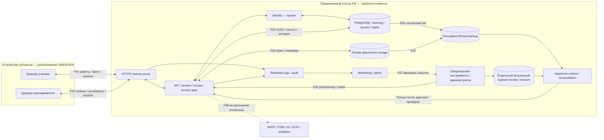

# L0.1 — Потоки данных и локализация

> L0.2: актуальная квалификация сторон — [controller/processor model](PD-CONTROLLER-PROCESSOR-MODEL.md). Историческое предположение об ООО как единственном операторе ниже уточняется по целям; см. amendment в конце.

**FACT:** [Compose](../../docker-compose.yml) — локальный Development: nginx → API → PostgreSQL 17.6, два volumes; bearer adapter в браузере. **PROPOSAL:** следующая схема пилота. Ни одного выбранного реального ЦОД/провайдера нет. Норма локализации и трансграничной передачи: [R05/R06](PD-LEGAL-REQUIREMENTS.md), **LEGAL SOURCE NOT VERIFIED**.

Identity физически предлагается в той же БД, отдельный узел означает ответственность, не отдельный сервер. Operator case tooling пока отсутствует; restricted CLI — предложение. Browser local RAM/Blob/download содержит ПД вне DB. Изображение устройства/место проживания не определяется кодом.

| Flow | Данные / граница / получатель | Минимизация и контроль | Evidence / owner / статус |
|---|---|---|---|
| F01/F02 | Пароли/session, решения/фото, учебные metadata, преподавательский feedback; Интернет → edge → API → разрешённый браузер | Same-origin TLS, JWT scope по T04/ADR-L15, CSRF при cookies, no public photos, no-store; запрет body/token в edge logs | HTTPS/IDOR/CSRF/browser trace с synthetic; engineer/ИБ; PROPOSAL |
| F03 | API/Identity → DB: I01–I08/I10/I15 | Private network; минимальные DB роли; база/replicas/WAL в утверждённых местах | DB endpoints/ports, contract ЦОД, config inventory; ops; UNKNOWN |
| F04 | Фото/EXIF в private FS; stream через API | Не CDN/public bucket, random storage keys не заменяют authorization; EXIF policy PD-G04 | Storage paths/access tests, inventory snapshots; ops; часть FACT local, pilot NOT VERIFIED |
| F05 | Полный набор и manifest → off-host; provider support/snapshots | Шифрование + отдельный key custody, сроки и erasure copies, реестр всех backup locations | Договор/поручение, регион всех copies, clean-host drill; ops/ПД; UNKNOWN |
| F06 | Issuer/ПД/админ → account/roster/cases/DB при maintenance | Именной least privilege, отдельный maintenance credential; никаких ученических фото в tickets/chat/Git | Access register, action audit и договоры внешних admins; директор; NOT VERIFIED |
| F07 | Logs → monitoring → alert channel | Route template/status/case ID, без body/UUID если не нужен; канал alert тоже внешний получатель при наличии | Log agent configuration, egress capture, canary; ИБ/ops; NOT VERIFIED |
| F08 | Внешние SMTP/analytics/CDN/error tracking/AI/OCR | В MVP не подключать; каждый новый flow получает цель, минимальные поля, роль получателя, регион, retention, уведомления | Vendor review/ADR и legal approval до включения; ПД; DISABLED BY PROPOSAL |

## Внешние зависимости: checklist PD-G05

| Зависимость | Что проверить до пилота | Рекомендация / статус |
|---|---|---|
| VPS + управляемая панель + support | Физический адрес ЦОД, страна backups/snapshots/telemetry, доступ сотрудников/субподрядчиков, собственные цели провайдера | РФ для контура; provider UNKNOWN |
| PostgreSQL/Identity | Основная база, реплики, WAL, дампы, pgadmin/remote SQL и экспорт | Private РФ; operational config UNKNOWN |
| Файлы/временные uploads | Data disk, temp files, snapshots, preview cache | РФ; retention/deletion proof UNKNOWN |
| Backup vendor / keys | Все replicas, immutable locks, удаление, сроки восстановления ключа, местонахождение escrow | Off-host в РФ; невозможность timely erasure блокирует выбор |
| Monitoring/error tracking | Payloads, IP, stack/SQL values, agents, export и support | Self-host в РФ, минимум событий; SaaS отсутствует в текущем коде |
| SMTP/канал activation | Адрес ребёнка/родителя, token, доставка/архив, relays и местонахождение | Manual channel после согласования; SMTP не требуется по умолчанию |
| Analytics/CDN/fonts/scripts | Browser requests, cookies, IP/referrer, URL со student/work IDs | Bundled assets; проверить network trace, не предполагать отсутствие egress только по package list |
| DNS/ACME/регистратор | Контактные данные аккаунта, доменные запросы, provider logs; DNS не равен передаче содержимого работ | Проверить фактический payload; не объявлять любой иностранный DNS незаконным |
| AI/OCR | Полный контент, обучение модели, retention, subprocessors, страны | Не реализовано/выключено; новый gate перед интеграцией |
| CI/Git/package registries | Telemetry/build logs, fixtures, error upload; package download сам по себе не передача ПД учащихся | Только synthetic; не загружать реальные дампы/фото в разработки/AI-инструменты |
| Удалённый администратор/браузер за рубежом | Фактический доступ и получатель, место обработки и передачи, основание | Индивидуальный правовой анализ; не ограничиваться адресом VPS |

Локализация по ст. 18 ч. 5 и трансграничная передача по ст. 12 — разные проверки. Вход/backup/логи за пределами РФ не становятся допустимыми лишь от наличия PostgreSQL в РФ; зарубежный сервис не запрещён автоматически без анализа операций, субъектов, оснований и уведомлений. Для пилота рекомендован весь управляемый контур в РФ и отсутствие необязательных внешних потоков. Это снижает объём доказательств, но не является доказательством соблюдения.

Evidence packet: подписанный перечень систем/получателей/адресов ЦОД, договоры с provider commitments, egress allowlist + network trace, конфигурации без секретов, backup manifests/удаление, проверка remote support и version/date/owner. IP-geolocation в одиночку не достаточна.

## L0.2 — организационное уточнение

F01/F02: браузер→проверенный membership→course owner→context→scope query, без объединения A/B. F03/F04: shared DB/private storage не объединяют правовые роли; pending binding и parent-file guards обязательны. F05: backup содержит несколько contexts, ledger/сроки по каждому, restore quarantine до reconciliation всех. F06: A утверждает roster/case, P исполняет в пределах поручения; platform administrator не получает учебный read. F07/support: минимальные события, временный допуск и отдельный purpose review; F08 по-прежнему не разрешён автоматически. Дополнительный будущий поток P как организатор B изолирован от A, передачи истории между ними по умолчанию нет. [Роли/договор](PD-CONTROLLER-PROCESSOR-MODEL.md), [копии](PD-ORGANIZATION-LIFECYCLE.md).
